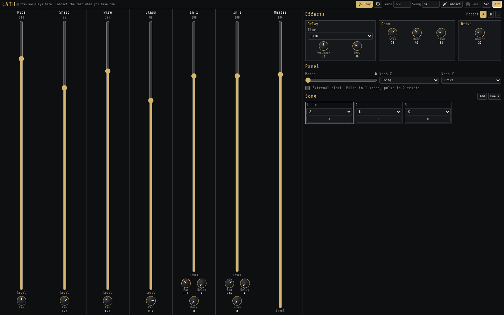

# LATH

Tracker for the Music Thing Workshop Computer. Four drum voices, two CV and gate tracks, a mixer for the audio inputs, and delay, room and drive. The page talks to the card over USB MIDI. Patterns also preview in the browser.

Web editor and control panel: [https://gordonbleu-modular.github.io/lath/](https://gordonbleu-modular.github.io/lath/)

Chrome or Edge on a computer. Web MIDI does not work on iOS.

## Start

1. Hold the Computer boot button, plug in USB, and copy `public/LATH.uf2` onto the drive that appears.
2. Open this site and press **Connect**. The device is named LATH.
3. Press **Save** to store the song on the card. After that it runs from the panel with USB unplugged.

The browser also plays a preview, so you can write patterns before the card is connected.

**Tempo** and **Swing** are the numbers in the top bar. Type a new value. **Play** starts the preview. **Save** writes the card.

On the module, the switch up stops, the middle plays, and a down click queues the next song step. The big knob morphs between presets A, B and C. The two small knobs do whatever you assign on the mixer.

## Sequencer

**Pattern** A–H is the pattern you are editing. **Clear** erases that pattern. **Copy to** duplicates it onto another letter.

The grid is six tracks, at most 32 steps. Each track has its own length, so they can loop against each other. Steps past that length are dim. The header of a track shortens it, lengthens it, or mutes it.

Click a step, then set it on the right:

- The note buttons, or the computer keyboard. Z is C, the Q row is the octave above. Comma and period move the octave. **Rest** clears the step.
- **Velocity** and **Length**. On the CV tracks, length is the gate time.
- **Command** and **Value**.

| Command | What the value does |
| --- | --- |
| R | Retrigger. How many hits fit in the step, from 2 to 8. |
| D | Extra delay send on this hit. |
| B | Extra room send on this hit. |
| C | Crush. Holds and bites the hit. |
| P | Pitch offset. 24 is unchanged. |
| ? | Probability. The hit plays if a roll lands under this. |
| G | Tone for this drum hit, or glide time on a CV track. |
| K | Choke. Silences the track for the next N steps. |

**Preset** A, B and C are three stored sounds. The drums on the right edit the selected preset: decay, tone, pitch, and one extra control. **Wires** on the snare adds the rattle. Glass can be Glass, Wood, Zap or Tom.

## Mixer

Each drum is a channel strip: a vertical **Level** fader and a **Pan** knob. Drag a knob upward to turn it up.

**In 1** and **In 2** are the audio inputs on the Computer. Patch the oscillators back in here. They have the same level and pan, plus **Delay** and **Room** sends. **Master** is the last fader.

The right side is stored in the preset too:

- Delay time, feedback and the drum delay send.
- Room size, damp and the drum room send.
- Drive.

**Panel** is the hardware.

- **Morph** is what the big knob does, blending preset A into B into C. It is only a preview while the card is connected. The knob on the module wins.
- **Knob X** and **Knob Y** choose what the two small knobs control: swing, tempo, drive, effect levels, input levels and sends.
- **External clock** uses pulse in 1 as a step clock and pulse in 2 as reset.

**Song** is the order of patterns. **Add** grows the list, the letter picks the pattern, and **×** removes a step. **Queue** lines up the next one. It starts when the longest track of the current pattern wraps. The down click on the module does the same thing.

## GitHub Pages

Push this folder to `main` or `master`. The workflow is `.github/workflows/pages.yml`. In the repo, set Settings → Pages → Source to GitHub Actions.
