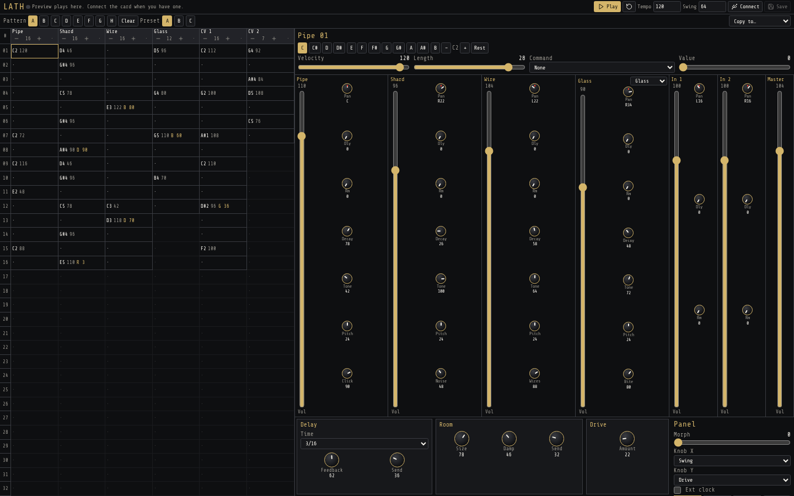

# LATH

Tracker for the Music Thing Workshop Computer. Four drum voices, two CV and gate tracks, a mixer for the audio inputs, and delay, room and drive. The page talks to the card over USB MIDI. Patterns also preview in the browser.

Web editor and control panel: [https://gordonbleu-modular.github.io/lath/](https://gordonbleu-modular.github.io/lath/)

Chrome or Edge on a computer. Web MIDI does not work on iOS.

## Start

1. Hold the Computer boot button, plug in USB, and copy `public/LATH.uf2` onto the drive that appears.
2. Open this site and press **Connect**. The device is named LATH.
3. Press **Save** to store the song on the card. After that it runs from the panel with USB unplugged.

The browser also plays a preview, so you can write patterns before the card is connected.

**Tempo** and **Swing** are the numbers in the top bar. Type a new value. **Play** starts the preview. **Save** writes the card.

On the module, the switch up stops, the middle plays, and a down click queues the next song step. The big knob morphs between presets A, B and C. The two small knobs do whatever you assign on the mixer.

## The page

Everything is on one screen. The grid is a narrow column on the left. The step you are editing sits above the desk, and the instruments, the mixer and the effects fill the right side.

**Pattern** A–H is the pattern you are editing. **Clear** erases it. **Preset** A, B and C are the three stored sounds. **Copy to** duplicates the pattern onto another letter.

The grid is six tracks, at most 32 steps. Each track has its own length. Steps past that length are dim. The header of a track shortens it, lengthens it, or mutes it.

Click a step, then set it on the right. The note buttons, or the computer keyboard: Z is C, the Q row is the octave above. Comma and period move the octave. **Rest** clears the step. **Velocity** and **Length** sit under the notes. On the CV tracks, length is the gate time.

A command shows on the step as its letter and value, such as `R 3`.

| Command | What the value does |
| --- | --- |
| R | Retrigger. How many hits fit in the step, from 2 to 8. |
| D | Extra delay send on this hit. |
| B | Extra room send on this hit. |
| C | Crush. Holds and bites the hit. |
| P | Pitch offset. 24 is unchanged. |
| ? | Probability. The hit plays if a roll lands under this. |
| G | Tone for this drum hit, or glide time on a CV track. |
| K | Choke. Silences the track for the next N steps. |

## The desk

Each drum is a strip on the right. **Vol** is the fader. **Pan** is centered at 12 o'clock. **Dly** and **Rm** are that instrument's sends. The other knobs are the sound: decay, tone, pitch, and click, noise, wires or bite. Glass has a model: Glass, Wood, Zap or Tom. Drag a knob upward to turn it up. Off is 7 o'clock, full is 5 o'clock.

**In 1** and **In 2** are the audio jacks. Patch the oscillators back in here. They have level, pan and the same two sends. **Master** is the last fader.

Delay, Room and Drive sit in their own boxes. Their Send knobs are the extra send for the whole drum bus, on top of the channel sends.

**Panel** is the hardware. **Morph** is the big knob, blending preset A into B into C. While the card is connected, the knob on the module wins. **Knob X** and **Knob Y** choose what the two small knobs control. **Ext clock** uses pulse in 1 as a step clock and pulse in 2 as reset. The letters under that are the song. **Queue** lines up the next pattern. It starts when the longest track wraps. The down click on the module does the same thing.

